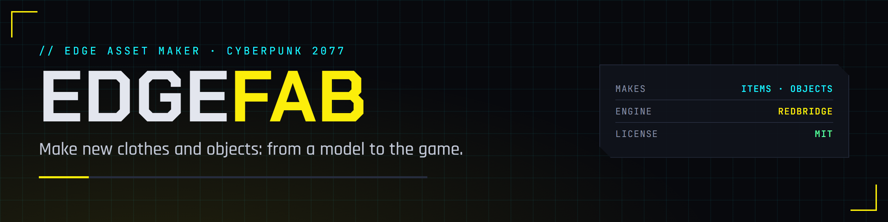

  

  
  
  
  
  

The EDGE asset maker for Cyberpunk 2077, a VS Code extension in the EDGE family. Bring a 3D model from Blender or an AI model service, and EDGEfab turns it into a new object or a piece of clothing that works in the game: materials and looks, the files the game needs, a name and an icon, and one click to try it in the running game. Or skip the UI: EDGEfab's MCP server lets REDagent or Claude do it when you say "make this model a jacket V can wear".

EDGEfab orchestrates the other EDGE tools: [EDGEmat](https://github.com/Edgemodders/EDGEmat) for materials and looks, [REDcode](https://github.com/Edgemodders/REDcode) for the project and the 3D viewer, [REDbridge](https://github.com/Edgemodders/REDbridge) for game files, [REDdeck](https://github.com/Edgemodders/REDdeck) and [REDnode](https://github.com/Edgemodders/REDnode) to try the result, and [EDGEbuilder](https://github.com/Edgemodders/EDGEbuilder) to place objects in the world.

**[Read the docs](https://edgemodders.github.io/EDGEfab/)** &middot; [Design](docs/design.md) &middot; [Dev setup](docs/dev-setup.md)

> [!NOTE]
> **Status: scaffold.** The repository, the branding, the docs site and a design brief (draft 0.1) exist; there is no code yet. Next: F0, decisions with the owner.

## Repository layout

| Path | Contents |
|---|---|
| `docs/` | Documentation site: the design and dev setup |
| `tools/brand/` | Renders the banner, icon and badges; `activity.svg` is the activity bar icon |

## Legal

EDGEfab is MIT. Like REDcode, it talks to REDbridge (GPL-3.0, because it links WolvenKit) only as a separate process and never links it. This repository contains no game files and no data extracted from them. Single-player modding only. EDGEfab is not affiliated with CD Projekt RED.

## License

[MIT](LICENSE)
