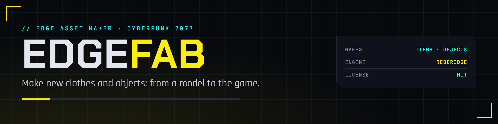
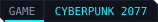

  

  
  
  
  
  

The EDGE asset maker for Cyberpunk 2077, a VS Code extension in the EDGE family. Bring a 3D model from Blender or an AI model service, and EDGEfab turns it into a new object or a piece of clothing that works in the game: materials and looks, the files the game needs, a name and an icon, and one click to try it in the running game. Or skip the UI: EDGEfab's MCP server lets REDagent or Claude do it when you say "make this model a jacket V can wear".

EDGEfab orchestrates the other EDGE tools: [EDGEmat](https://github.com/Edgemodders/EDGEmat) for materials and looks, [REDcode](https://github.com/Edgemodders/REDcode) for the project and the 3D viewer, [REDbridge](https://github.com/Edgemodders/REDbridge) for game files, [EDGEdeck](https://github.com/Edgemodders/EDGEdeck) and [REDnode](https://github.com/Edgemodders/REDnode) to try the result, and [EDGEbuilder](https://github.com/Edgemodders/EDGEbuilder) to place objects in the world.

EDGEfab is a fabricator, not a mesh editor: its goal is the whole game asset. Props, clothing, characters and NPCs, with their materials, rigs, animations, voice and records. Right-click an asset and **Open in EDGEfab** to change any part of it by prompts, in one place: "make the jacket green and the sleeves red" (through EDGEmat), "make an old worn trenchcoat" (through a text-to-3D service such as Tripo), "animate the pinwheel" (through Blender or Unreal Engine), "give this NPC a deeper voice" (through EDGEwave). Assets come in from Blender and Unreal Engine alike (meshes, materials, rigs, animations), and animation, imported or generated, is a key focus. In time, EDGEfab also brings free and royalty-free Unreal Engine assets into the game.

**[Read the docs](https://edgemodders.github.io/EDGEfab/)** &middot; [Build plan](docs/plan.md) &middot; [Design](docs/design.md) &middot; [UE5 assets](docs/ue-assets.md) &middot; [Dev setup](docs/dev-setup.md)

> [!NOTE]
> **Status: F1 props, not released yet.** F0's checks are done: Tripo's v3 API makes a textured model, and a prepared GLB imports over a game prop (2026-10-31 and 11-01); which collision is solid in the game is still open. F1, the first build, has started: the extension's Desk view, **Import a GLB** and **Generate with Tripo**, the step that gets a model ready for the game (size, levels of detail, textures), and the MCP server (`fab_make`, `fab_desk`, `fab_tripo`). They pass the smoke test, but have not run in VS Code yet (unverified). Next: the collision check in the game, then **Add to Project**. There is no release yet. The phases are in the [build plan](docs/plan.md).

## Repository layout

| Path | Contents |
|---|---|
| `docs/` | Documentation site: the design and dev setup |
| `tools/brand/` | Renders the banner, icon and badges; `activity.svg` is the activity bar icon |

## Legal

EDGEfab is MIT. Like REDcode, it talks to REDbridge (GPL-3.0, because it links WolvenKit) only as a separate process and never links it. This repository contains no game files and no data extracted from them. Single-player modding only. EDGEfab is not affiliated with CD Projekt RED.

## License

[MIT](LICENSE)
