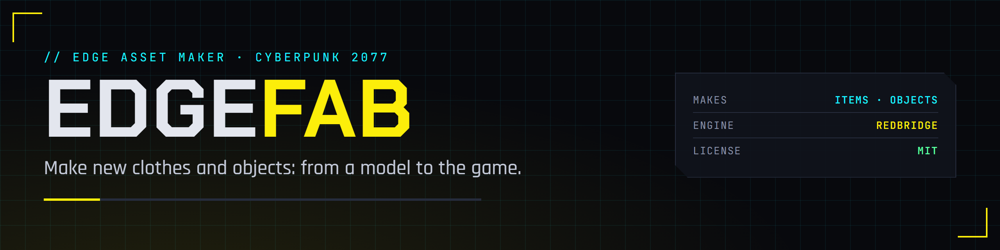
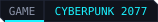
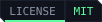

  

  
  
  
  
  

The EDGE asset maker for Cyberpunk 2077, a VS Code extension in the EDGE family. Bring a 3D model from Blender or an AI model service, and EDGEfab turns it into a new object or a piece of clothing that works in the game: materials and looks, the files the game needs, a name and an icon, and one click to try it in the running game. Or skip the UI: EDGEfab's MCP server lets REDagent or Claude do it when you say "make this model a jacket V can wear".

EDGEfab orchestrates the other EDGE tools: [EDGEmat](https://github.com/Edgemodders/EDGEmat) for materials and looks, [REDcode](https://github.com/Edgemodders/REDcode) for the project and the 3D viewer, [REDbridge](https://github.com/Edgemodders/REDbridge) for game files, [EDGEdeck](https://github.com/Edgemodders/EDGEdeck) and [REDnode](https://github.com/Edgemodders/REDnode) to try the result, and [EDGEbuilder](https://github.com/Edgemodders/EDGEbuilder) to place objects in the world.

EDGEfab is a fabricator, not a mesh editor: its goal is the whole game asset. Props, clothing, characters and NPCs, with their materials, rigs, animations, voice and records. Right-click an asset and **Open in EDGEfab** to change any part of it by prompts, in one place: "make the jacket green and the sleeves red" (through EDGEmat), "make an old worn trenchcoat" (through a text-to-3D service such as Tripo), "animate the pinwheel" (through Blender or Unreal Engine), "give this NPC a deeper voice" (through EDGEwave). Assets come in from Blender and Unreal Engine alike (meshes, materials, rigs, animations), and animation, imported or generated, is a key focus. In time, EDGEfab also brings free and royalty-free Unreal Engine assets into the game.

**[Read the docs](https://edgemodders.github.io/EDGEfab/)** &middot; [Build plan](docs/plan.md) &middot; [Design](docs/design.md) &middot; [UE5 assets](docs/ue-assets.md) &middot; [Dev setup](docs/dev-setup.md)

> [!NOTE]
> **Status: 0.2.1 preview released on 2026-11-25** on the [VS Code Marketplace](https://marketplace.visualstudio.com/items?itemName=edgemodders.edgefab) and [Open VSX](https://open-vsx.org/extension/edgemodders/edgefab), with its MCP server on npm (`@edgemodders/edgefab-mcp`), the core for other tools (`@edgemodders/edgefab-core`), and a page on [Nexus Mods](https://www.nexusmods.com/cyberpunk2077/mods/38605). It makes **props**: a textured GLB of your own, or an object from your words (a picture drawn by OpenAI's GPT Image, then a 3D model by Tripo, in named parts), made ready for the game (real size, three levels of detail, glow, back faces) and put into your REDcode project with **Add to Project** (mesh, materials, an entity that is solid), or kept in the EDGE Library. F1, the first build, passed its tests on 2026-11-14 and 15, in VS Code and in the game with two props placed with EDGEbuilder ([Tests](https://edgemodders.github.io/EDGEfab/testing.html)). **On main, not released:** F3 Blender sources started on 2026-11-26, with `.blend`, FBX and OBJ files onto the Desk through Blender in the background (its VS Code steps still to run). Clothing, NPC looks and animated props come in later phases: the [build plan](docs/plan.md).

## Repository layout

| Path | Contents |
|---|---|
| `extensions/edgefab/` | The VS Code extension; its core (`src/core`, no VS Code imports) is shared with the MCP server and the core package |
| `packages/edgefab-mcp/` | The MCP server, `@edgemodders/edgefab-mcp` |
| `packages/edgefab-core/` | The core for other EDGE tools, `@edgemodders/edgefab-core` |
| `docs/` | Documentation site: the plan, design, tests, changelog and dev setup |
| `nexus/` | The Nexus Mods page's description and upload settings |
| `tools/release/` | The release's checks, notes and Nexus zip |
| `tools/brand/` | Renders the banner, icon and badges; `activity.svg` is the activity bar icon |

## Legal

EDGEfab is MIT. Like REDcode, it talks to REDbridge (GPL-3.0, because it links WolvenKit) only as a separate process and never links it. This repository contains no game files and no data extracted from them. Single-player modding only. EDGEfab is not affiliated with CD Projekt RED.

## License

[MIT](LICENSE)
